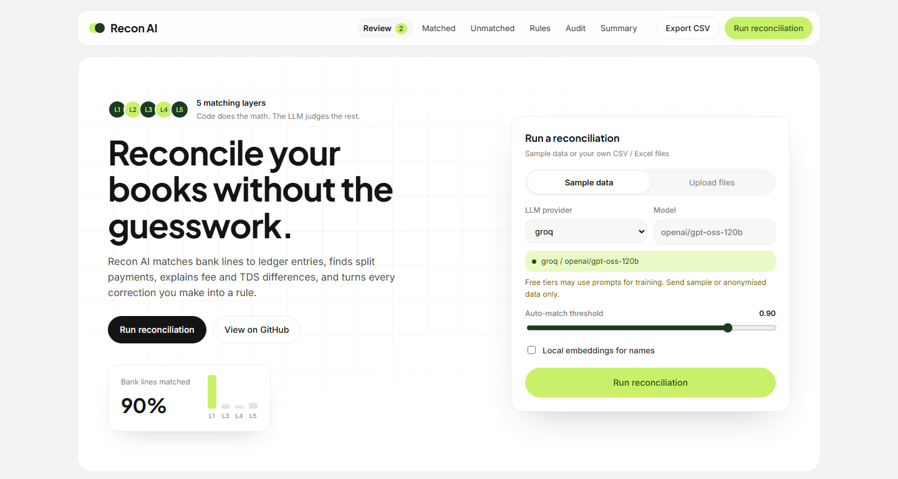
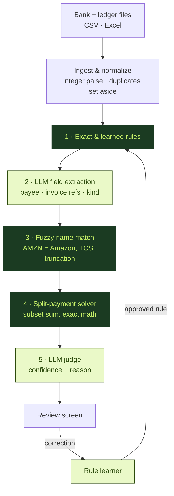
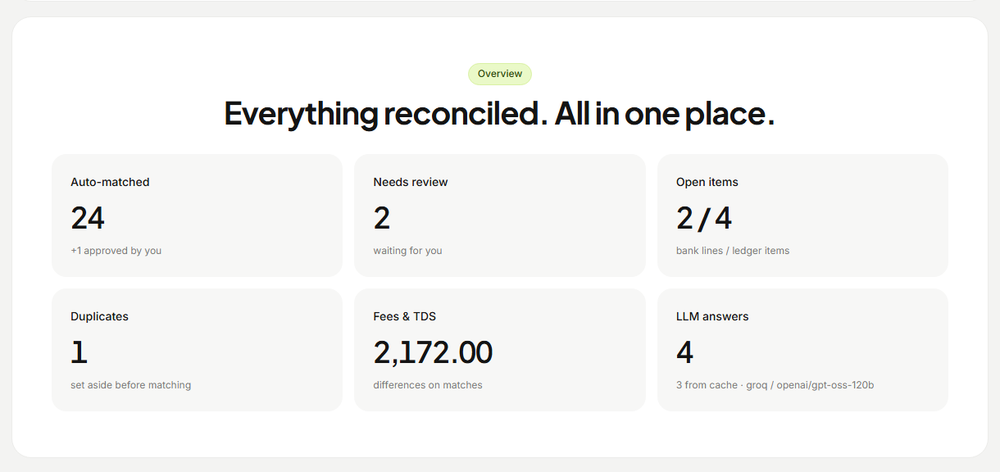
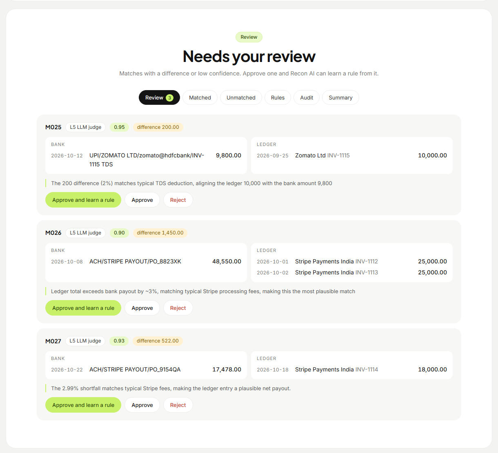
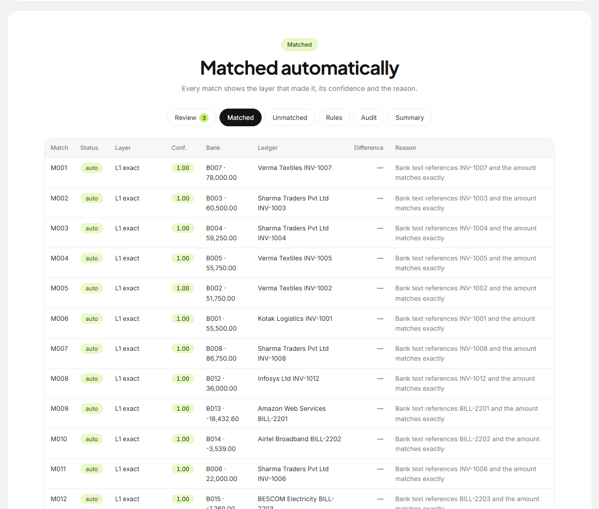
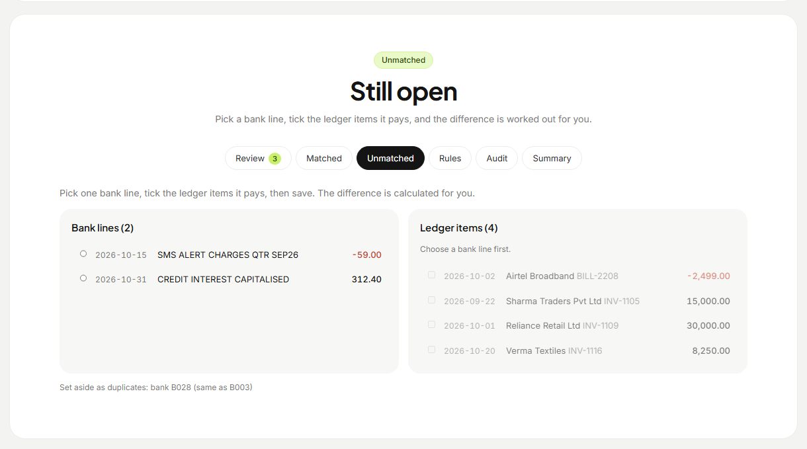
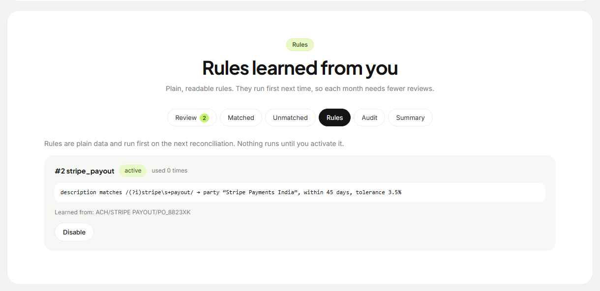
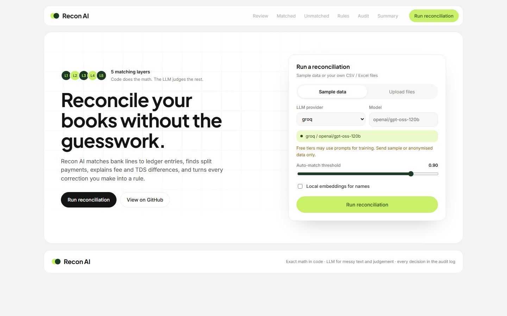

<div align="center">

# 🟢 Recon AI

### Reconcile your books without the guesswork.

Bank-to-ledger reconciliation where **code does all the math**, an **LLM reads the messy text and judges the unclear cases**,
and **every correction you make becomes a reusable rule**.




</div>

---

## ✨ Why it's different

Most "AI reconciliation" tools hand the whole job to an LLM, which is slow and costs money on every run.
LLMs are also bad at adding numbers. Recon AI splits the work:

| | |
|---|---|
| 🧮 **Exact math, always** | Amounts are integer paise. Matching sums, fees and differences are computed in code, never by the model. |
| 🧠 **LLM only where it helps** | Reading `UPI/AMZN MKTP IN/…` as *Amazon*, and choosing between close candidates, with a written reason. |
| 🔁 **Learns from you** | Approve a tricky match and it becomes a readable rule. Next month that case is matched automatically, with no LLM call. |
| 🧾 **Audit-ready** | Every match, approval, rejection and rule change is logged with the layer, confidence and reason. |
| 🔒 **Private option** | Run fully offline with Ollama. Without any LLM, it falls back to deterministic heuristics. |

## 🏗️ How it works

Each layer only sees what the earlier layers left open.



<sub>🟩 light = uses an LLM · ⬛ dark = pure code</sub>

## 📸 Screenshots

<table>
<tr>
<td width="50%"><b>Overview</b><br/></td>
<td width="50%"><b>Needs review</b>, with the LLM's reason on each card<br/></td>
</tr>
<tr>
<td><b>Matched</b>, with layer, confidence and reason<br/></td>
<td><b>Unmatched</b>: match by hand, difference worked out for you<br/></td>
</tr>
<tr>
<td><b>Rules learned from you</b><br/></td>
<td><b>Before a run</b><br/></td>
</tr>
</table>

## 📊 Results on the sample set

`data/make_sample.py` generates 30 bank lines and 35 ledger items. They're built to break simple tools: split payments,
Stripe payouts with fees taken off, 2% TDS short-payments, `AMZN` vs `Amazon`, `MEHTA AND SONS` vs `Mehta & Sons`,
two open items with the same amount, a duplicated bank line, and items that should stay open.

| Mode | Matches found | Wrong matches | Auto-matched (all correct) | LLM calls |
|---|---|---|---|---|
| Offline heuristics | **27 / 27** | 0 | 24 | 0 |
| Groq `openai/gpt-oss-120b` | **27 / 27** | 0 | 24 | 4 |

With an LLM, the judge explains each difference, e.g. *"The 200 difference (2%) matches typical TDS deduction"*.
After you approve one Stripe payout with **Approve and learn a rule**, the next run matches every Stripe payout automatically.

## 🚀 Quick start

```powershell
pip install -r requirements.txt
python data\make_sample.py                 # made-up test data with the tricky cases
python run.py                              # CLI run, scored against data\sample\truth.csv

cd web; npm install; npm run build; cd ..
python -m uvicorn api:app --port 8000      # API + React app at http://localhost:8000
```

For frontend work, run `npm run dev` in `web/` (port 5173, proxies `/api` to 8000) next to uvicorn.

## ☁️ Deploy for free (Render)

[](https://render.com/deploy?repo=https://github.com/Saisinare/recon-ai)

The repo has a `Dockerfile` and a `render.yaml` Blueprint, so it runs on Render's free plan:

1. Sign in at [render.com](https://render.com) with GitHub, then **New → Blueprint** and pick this repo (or use the button above).
2. Paste your `GROQ_API_KEY` when Render asks for it, then **Apply**.
3. Your app is live at `https://recon-ai-xxxx.onrender.com` after the first build (about 5 minutes).

The Blueprint turns on **public demo mode** (`RECON_DEMO=1`):
- every visitor gets their own private session; no one sees anyone else's run, rules or audit log
- 5 Groq runs per visitor per hour (`RECON_DEMO_LLM_RUNS`), then the offline heuristics take over
- uploads are capped at 1 MB / 3,000 rows and always matched offline, never sent to an LLM

Free-plan caveats: the service sleeps after ~15 minutes idle (the first visit takes 30–60 s to wake it), and there's no
lasting disk, so learned rules and the audit log reset when it restarts.

## 🤖 LLM providers (free options)

Copy `.env.example` to `.env` and set `RECON_PROVIDER` plus the key for the provider you use.

| Provider | Setup | Notes |
|---|---|---|
| `none` | nothing | offline heuristics |
| `ollama` | `ollama pull qwen2.5:7b` | runs on your PC; **use this for real financial data** |
| `groq` | `GROQ_API_KEY` | fast; default `openai/gpt-oss-120b` |
| `gemini` | `GEMINI_API_KEY` | free tier may use prompts for training |
| `openrouter` | `OPENROUTER_API_KEY` | `:free` models, about 50 requests a day |

> ⚠️ Free cloud tiers may train on your prompts. Send them sample or anonymised data only.

Every LLM answer is cached in SQLite, so re-running the same data costs nothing. If a call fails, that step falls back to the heuristics.

## 📁 Your own files

**Bank file:** date, description, and either amount or credit/debit columns.
**Ledger:** date, party and amount, plus optional `doc_no` and `type` (rows typed *bill* or *payable* count as money out).
Common column names (narration, particulars, withdrawal, customer, vendor, invoice no…) are recognised automatically.

## 🗂️ Project layout

```
api.py            FastAPI: runs the pipeline, review actions, rules, audit, export
web/              React (Vite) review screen
run.py            CLI + scoring against the answer key
core/ingest.py    parsing and normalising (integer paise)
core/rules.py     layer 1 + learned rules
core/extract.py   layer 2: LLM field extraction
core/fuzzy.py     layer 3: name similarity (+ optional local embeddings)
core/solver.py    layer 4: split payments / subset sum
core/judge.py     layer 5: LLM judge
core/learner.py   corrections → rules (regex safety-checked)
core/summary.py   month-end note
core/store.py     SQLite: rules, audit log, LLM cache
llm/gateway.py    one client for Ollama / Groq / Gemini / OpenRouter
```
